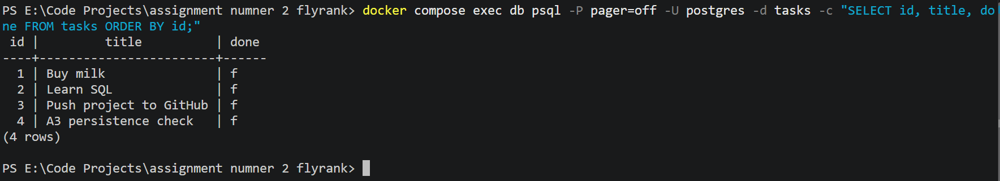

# Tasks API — FastAPI, PostgreSQL & Docker Compose

A REST API for managing tasks, built with FastAPI and PostgreSQL. Docker Compose runs the application and database together, while a named Docker volume preserves database records across container restarts.

**FlyRank assignment:** A3 — Containerize Your Stack (BE-04)

## Technology Stack

- Python and FastAPI
- PostgreSQL
- Docker and Docker Compose

## Features

- Create, read, update, and delete tasks (CRUD).
- Initialize the database table automatically at application startup.
- Insert three example tasks when the table is empty.
- Validate requests and return appropriate HTTP responses.
- Use parameterized SQL queries.
- Persist database records in a named Docker volume.
- Provide interactive API documentation through Swagger UI.

## Prerequisites

- Docker Desktop installed and running.
- Git installed if you plan to clone the repository.

## Project Structure

```text
.
├── docs/
│   └── postgres-tasks.png
├── .dockerignore
├── .env.example
├── .gitignore
├── Dockerfile
├── compose.yaml
├── db.py
├── main.py
├── requirements.txt
└── README.md
```

## Configuration

From the project directory, create a local `.env` file using the example configuration.

On Windows PowerShell:

```powershell
Copy-Item .env.example .env
```

The configuration includes the following variables:

| Variable | Purpose |
|---|---|
| `POSTGRES_PASSWORD` | Password used by PostgreSQL |
| `DATABASE_URL` | Connection string used by the application |

The example configuration is intended for local development. Keep `.env` and any real credentials out of version control. The `.env.example` file should contain only safe example values.

## Run the Application

Build the application image and start the application and database:

```bash
docker compose up --build
```

Docker Compose starts PostgreSQL, waits for its configured health check, and starts the API.

Once the services are running, access:

- **API:** http://localhost:3000
- **Interactive API documentation:** http://localhost:3000/docs
- **PostgreSQL host port:** `5432`

To run the containers in the background:

```bash
docker compose up --build -d
```

To check their status:

```bash
docker compose ps
```

## API Endpoints

| Method | Endpoint | Success Response | Common Errors |
|---|---|---|---|
| GET | `/tasks` | 200 OK | — |
| GET | `/tasks/{id}` | 200 OK | 404 Not Found |
| POST | `/tasks` | 201 Created | 400 Bad Request for an invalid title |
| PUT | `/tasks/{id}` | 200 OK | 400 Bad Request or 404 Not Found |
| DELETE | `/tasks/{id}` | 204 No Content | 404 Not Found |
| GET | `/stats` | 200 OK | — |

Optional filters include:

- `GET /tasks?search=milk` — search tasks.
- `GET /tasks?done=true` — filter by completion status.
- `GET /tasks?sort=title` — sort tasks by title.

For request schemas and additional endpoint details, visit the interactive documentation at http://localhost:3000/docs.

## Test the API

### List tasks

```bash
curl -i http://localhost:3000/tasks
```

### Create a task

```bash
curl -i -X POST http://localhost:3000/tasks \
  -H "Content-Type: application/json" \
  -d '{"title":"Test Docker setup","done":false}'
```

A successful creation should return `201 Created`.

### Check statistics

```bash
curl -i http://localhost:3000/stats
```

## Database Initialization and Persistence

The application creates the `tasks` table during startup and inserts three example tasks only when the table is empty.

PostgreSQL data is stored in the named Docker volume `taskdata`. Stopping and removing the containers does not remove this volume unless it is explicitly deleted.

### Inspect the Database

With the containers running, connect to PostgreSQL:

```bash
docker compose exec db psql -U postgres -d tasks
```

At the PostgreSQL prompt, run:

```sql
\dt
SELECT * FROM tasks ORDER BY id;
```

- `\dt` lists the database tables.
- The `SELECT` statement displays the stored task records.

To exit the PostgreSQL prompt, run:

```sql
\q
```

### Verify Persistence

To check that records survive a container restart:

1. Start the application and database.
2. Query PostgreSQL and confirm that the task records exist.
3. Stop the containers without deleting the database volume:

   ```bash
   docker compose down
   ```

4. Start the services again:

   ```bash
   docker compose up -d
   ```

5. Query PostgreSQL again and confirm that the records remain.

**Recorded test result:** In the development test, the three example tasks—`Buy milk`, `Learn SQL`, and `Push project to GitHub`—remained available after the containers were restarted.

**Important:** Do not use `docker compose down -v` during this test, because it removes the Compose-managed volume.

### Database Screenshot

The following image documents the PostgreSQL tasks table and its records.



The screenshot should be committed to the repository at `docs/postgres-tasks.png`.

## Implementation Notes

- `.env` is excluded from Git.
- `.env.example` documents the required configuration variables.
- SQL queries use parameterized values.
- Docker Compose manages the application and PostgreSQL containers.
- A named Docker volume preserves database records across container recreation.

## Repository

[View the project on GitHub](https://github.com/Waqas392/fastapi-sqlite-tasks)
