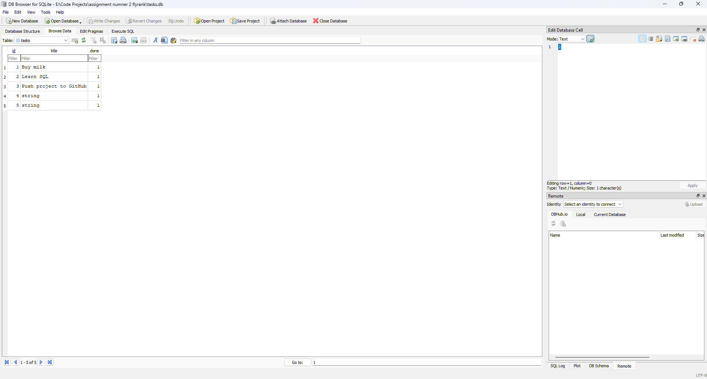
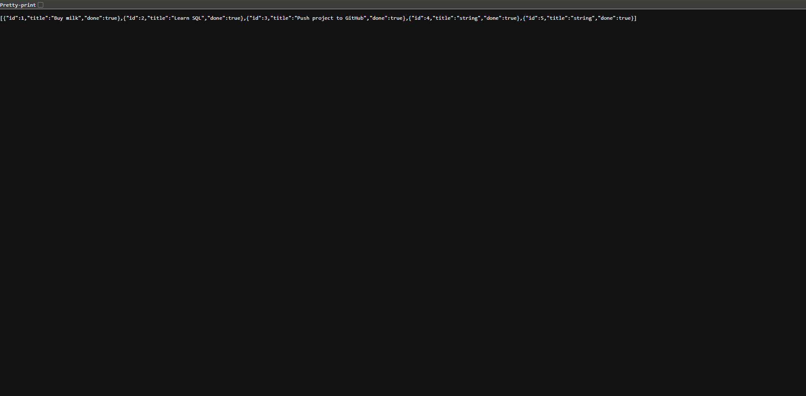

# Tasks API — SQLite edition (FlyRank BE-02 / A2)

The CRUD API from Assignment 1, with the in-memory list replaced by a real
SQLite database. The endpoints, request bodies, responses and status codes are
unchanged — only the storage layer moved from memory to disk.

**Stack:** Python · FastAPI · built-in `sqlite3`

## Why SQLite?
- It is a single file, so there is no database server to install or run.
- It needs zero setup: the file is created the first time the app starts.
- Data survives restarts, which was the whole limitation of the in-memory version.
- It ships with Python (`sqlite3`), so there is no extra dependency.

## Where the database lives
`tasks.db`, next to `main.py`. It is created automatically on startup, together
with the `tasks` table, and three example tasks are seeded **only** when the
table is empty. The file is git-ignored, so every fresh clone starts clean.

```sql
CREATE TABLE IF NOT EXISTS tasks (
    id    INTEGER PRIMARY KEY,
    title TEXT    NOT NULL,
    done  BOOLEAN NOT NULL DEFAULT 0
);
```

## How to run
```bash
pip install -r requirements.txt
uvicorn main:app --reload
```
The API is now at http://localhost:8000 (interactive docs at `/docs`).

## Endpoints
| Method | Path | Success | Errors |
|---|---|---|---|
| GET | `/tasks` | 200 | — |
| GET | `/tasks/{id}` | 200 | 404 `{"error": "Task not found"}` |
| POST | `/tasks` | 201 | 400 missing/empty title |
| PUT | `/tasks/{id}` | 200 | 400 invalid body, 404 unknown id |
| DELETE | `/tasks/{id}` | 204 | 404 unknown id |

Extras: `GET /tasks?search=milk` (SQL `LIKE`), `GET /tasks?done=true`
(SQL `WHERE`), `GET /tasks?sort=title` (SQL `ORDER BY`), `GET /stats`
(SQL `COUNT`).

All queries use parameterized placeholders (`?`), so user input is never glued
into SQL strings. Seeding runs inside a single transaction, so it is
all-or-nothing.

## Proof the API didn't change
The same `curl` commands from Assignment 1 pass unchanged against this version:
same URLs, same JSON, same status codes (200 / 201 / 204 / 400 / 404). Because
identical tests still pass, the storage really is an implementation detail
behind the API.

## Database viewer


## Example SQL I ran (Stage 4)
```sql
SELECT * FROM tasks WHERE done = 1;
```
It returned no rows at first, because no task was completed yet. After running
`UPDATE tasks SET done = 1;`, the same query returned every task.
